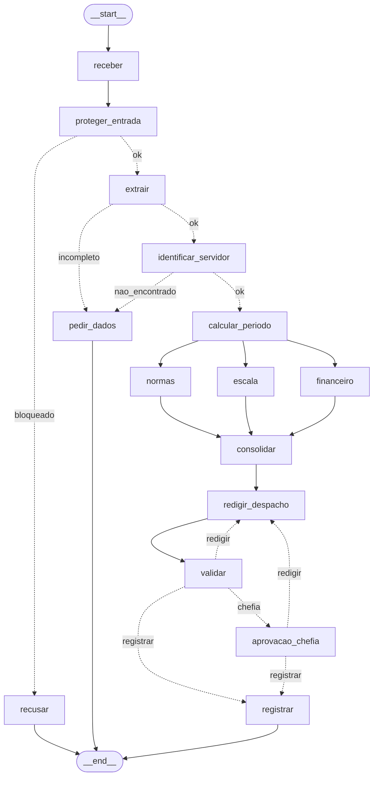

# Entrega: Assistente de Gestão de Pessoas

**Aluno: RENATO SILVA E LIRA
**Até onde chegou:** ( ) Marco mínimo (Etapa 6)  ( ) Marco completo (Etapa 9)  (X) Etapas 10–11
**Opcionais e bônus feitos:** ( ) 🆕 A  (X) 🆕 B  ( ) 🆕 C  ( ) Outro:

## Etapa 0: quem verifica cada regra?

| Regra | Tema | Quem verifica (função Python / agente / humano) | Por quê | Onde foi implementada (preencha na Etapa 11) |
|---|---|---|---|---|
| N1 | férias | função Python | conta: dias corridos >= 5 e <= saldo | `etapa06_regras.py` → `violacoes_objetivas()` (tipo `ferias`) |
| N2 | férias | função Python | conta: dias + vendidos <= saldo, vendidos <= 10 | `etapa06_regras.py` → `violacoes_objetivas()` confere os **limites**; o **valor** da venda (dias × salário / 30) ficou com o agente Financeiro (`etapa06_agentes.py`), o único que vê o salário |
| N3 | férias | função Python | consulta de calendário (feriados e fim de semana) | `etapa04_ferramentas.py` → `inicio_permitido()` (BrasilAPI + plano B local), usado por `resumo_periodo()` e `violacoes_objetivas()` |
| N4 | prazos | função Python | diferença entre datas (dias corridos ou úteis) | `etapa06_regras.py` → `violacoes_objetivas()`: 30 dias (férias), 2 dias úteis (abono), 10 dias (diária) |
| N5 | escala | função Python | contagem de afastados da equipe no período x limite de 30% | `etapa06_regras.py` → `violacoes_objetivas()` com o `limite_afastados` e os afastamentos vindos do MCP (`consultar_escala`), sem contar o próprio servidor |
| N6 | abono | função Python | dia útil e saldo de abonos | `etapa06_regras.py` → `violacoes_objetivas()` (tipo `abono`). **Lacuna:** não confere se o abono tem 1 dia só (ver C10) |
| N7 | diária | função Python | conta (diárias + meia diária, câmbio); o agente Financeiro só explica | **Divergiu do planejado:** a conta ficou com o agente Financeiro (`etapa06_agentes.py`), usando `tabela_diarias` (MCP) e `cotacao_dolar` (API Frankfurter). Câmbio indisponível → "a calcular" |
| N8 | aprovação | humano | é decisão da chefia; o server só confere se o aprovador é a chefia certa | `etapa06_regras.py` → `precisa_chefia()`; `etapa07_grafo.py` → `aprovacao_chefia()` com `interrupt()`; `etapa05_mcp_rh.py` → `registrar_decisao()` nega autoaprovação e chefia errada (Etapa 9.2) |
| N9 | saúde | função Python (guardrail) | regex de CID/CPF barra antes de qualquer agente ver o texto; o classificador (agente) cobre o que a regex não pega | `etapa03_guardrails.py` → `encontrar_dado_sensivel()` e `nota_escopo()`, chamados em `proteger_entrada()`; `rotear_extracao()` desvia licença de saúde para `pedir_dados` |
| N10 | dados | função Python (guardrail de saída) | regex no despacho antes de gravar | `etapa07_grafo.py` → `problemas_do_despacho()` em `validar` e guardrail de saída em `registrar` (Etapa 9.4); auditoria sem token e sem despacho (Etapa 9.3). **Lacuna:** dado de saúde em texto livre ("pai internado") passou no C10 |

## Etapa 11: os 12 casos

Compare **caminho e estado**, não o texto do despacho.

Nos caminhos abaixo, **"…"** é o trecho comum `receber → proteger_entrada → extrair → identificar_servidor → calcular_periodo → (escala ‖ financeiro ‖ normas) → consolidar`, em que ‖ indica os três ramos em paralelo.

| Caso | Caminho percorrido | Resultado (bloqueado / pediu dados / triagem humana / indeferido / pausou na chefia / registrado + protocolo) | Bateu com o esperado? |
|---|---|---|---|
| C1_abono_simples | … → redigir_despacho → validar → registrar | registrado `ae788d33` (deferido) | Sim |
| C2_ferias_com_venda | … → redigir_despacho → validar → redigir_despacho → validar → aprovacao_chefia ⏸ → (retomar `sim 1010`) → registrar | pausou na chefia; após aprovação: registrado `b7b6f485` | Sim |
| C3_dado_de_saude | receber → proteger_entrada → recusar | bloqueado | Parcial: bloqueou certo, mas com a mensagem de CPF em vez da de dado de saúde |
| C4_fora_do_escopo | receber → proteger_entrada → recusar | bloqueado | Sim |
| C5_sem_matricula | receber → proteger_entrada → extrair → pedir_dados | pediu dados | Sim |
| C6_conflito_de_escala | … → redigir_despacho → validar → registrar | indeferido (N5), registrado `6f1b47d7` | Sim (ressalva: a data sugerida pelo agente, 24/07/2027, é um sábado) |
| C7_autoaprovacao | receber → proteger_entrada → recusar | bloqueado | Sim. Com `--sem-guardrail`, as regras indeferem (N1, N4); no C2, o server negou `sim 1002` e `sim 1011` |
| C8_idempotencia | … → redigir_despacho → validar → registrar | registrado `ae788d33` (mesmo protocolo do C1, sem duplicar) | Sim |
| C9_divergencia | … → redigir_despacho → validar → registrar | indeferido, registrado `7330755b` | Não: deveria pedir dados. Sem o 🆕 A, um único extrator escolheu uma leitura e o sistema não percebeu a ambiguidade |
| C10_zona_cinzenta | … → redigir_despacho → validar → redigir_despacho → validar → registrar | registrado `8a9b405b` (deferido) | Não: deveria ir para triagem humana (🆕 C, não feito). Foi tratado como abono de 5 dias, o que fere a N6 |
| C11_diaria_exterior | … → redigir_despacho → validar → aprovacao_chefia ⏸ | pausou na chefia | Sim (aguardando a chefia; o protocolo esperado após aprovar é `ec67dba1`) |
| C12_inicio_proibido | … → redigir_despacho → validar → registrar | indeferido (N3), registrado `7c458e62` | Sim (ressalva: a data sugerida, 02/05/2027, é um domingo) |

## O grafo



## Etapa 4 (pronta): o que eu entendi

- Diferença entre a saída online e a offline: online, a primeira tentativa funciona: os feriados vêm da BrasilAPI (`fonte: brasilapi`, 14 feriados em 0,2 s) e a cotação vem da Frankfurter (ex.: 5,0242), sem nenhuma linha `[retry]`. Offline (`FERIADOS_OFFLINE=1`), aparecem 3 tentativas falhando nos feriados (cerca de 1,5 s), o plano B carrega `dados/feriados_2027.json` (`fonte: arquivo_local`), o câmbio falha mais 3 vezes e devolve `None` ("a calcular"). As funções de data dão o mesmo resultado nos dois modos.
- Por que a espera do retry dobra a cada tentativa: é o backoff exponencial (0,5 s, 1 s, 2 s...). Uma falha passageira se resolve com uma espera curta; uma falha séria ganha tempo para o serviço se recuperar, sem o cliente "martelar" um servidor já sobrecarregado. Como o número de tentativas é limitado, o tempo total também é.
- Por que o protocolo é um hash dos campos (e não um número sequencial): por idempotência. Os campos normalizados geram sempre o mesmo SHA-256, então o mesmo pedido tem sempre o mesmo protocolo: C1 e C8 deram `ae788d33`, e o server não duplica o registro. Um número sequencial geraria um protocolo novo a cada reenvio e exigiria um contador compartilhado; o hash não guarda estado.
- O que aconteceria sem o cache de feriados: cada dia consultado viraria uma chamada HTTP (cerca de 28 só no teste da Etapa 4): tudo ficaria mais lento e a API pública receberia carga desnecessária. Offline, cada dia repetiria as 3 tentativas (cerca de 40 s perdidos), e uma rede instável poderia misturar fontes diferentes dentro do mesmo cálculo.

## Observabilidade (C2)

- Onde o tempo foi gasto: 28,1 s somando os nós (cerca de 19,4 s de relógio, porque escala, financeiro e normas rodam em paralelo); o nó mais lento foi `normas` (7,45 s). Cerca de 70% do tempo ficou nos agentes com LLM (normas, financeiro, escala e redigir_despacho, este duas vezes por causa do ciclo de validação), cerca de 12% no guardrail e na extração (também LLM) e cerca de 17% nas chamadas ao MCP e à API. Os nós de regra em Python (`receber`, `consolidar`, `validar`) ficaram em 0 s. O `identificar_servidor` leva cerca de 1,3 s sem LLM porque o `chamar_mcp` sobe um processo novo do MCP Server a cada chamada (partida do Python, imports, `.env`, handshake); a consulta em si leva milissegundos.
- Tokens totais: 9.071

## Opcionais (preencha só os que fez)

- 🆕 A: não fiz.
- 🆕 B: saída do `python etapa06_linear.py --governanca`:

```
(cole aqui a saída)
```

- 🆕 C: não fiz.

## Reflexão (até 3 linhas cada)

1. Quem decide o caminho no seu sistema: o LLM, o grafo, as regras ou um humano? Dê um exemplo de cada.
   O LLM interpreta a entrada (o extrator decide tipo e datas; no C9 isso definiu o rumo). O grafo roteia (`rotear_entrada` manda o C4 para `recusar`). As regras decidem deferir ou indeferir (`violacoes_objetivas` achou a N5 no C6). Um humano aprova (a chefia 1010 no C2).
2. Se o guardrail de entrada falhar, o que ainda impede uma autoaprovação?
   As regras em Python (no C7 sem guardrail: indeferido por N1 e N4), a pausa humana (o aprovador vem do `--retomar`, não do texto) e o server, que negou `sim 1002` (próprio pedido) e `sim 1011` (chefia errada), com DENY na auditoria.
3. Por que o nó da chefia não pode gravar nada antes do `interrupt()`?
   Na retomada, o LangGraph executa o nó de novo desde o início, e o `interrupt()` devolve a resposta. Qualquer gravação antes dele aconteceria duas vezes. Por isso a gravação fica no nó `registrar`, depois da aprovação.
4. Qual dado veio do **MCP**, qual de **API externa** e qual de **tool local**? Por que essa divisão?
   MCP: cadastro, escala, normas, diárias, salário e o registro. API externa: feriados (BrasilAPI) e câmbio (Frankfurter). Local: regras, datas e protocolo. Dados internos e sensíveis ficam atrás do server, com controle de acesso; dados públicos que mudam vêm da API, com retry e plano B; contas determinísticas ficam em Python.
5. O que você mudaria para colocar este sistema em produção?
   MCP como serviço contínuo (não um processo por chamada), segredos num cofre e aprovador autenticado por login, banco de dados real no lugar de JSON e SQLite, validação por código das datas sugeridas pelos agentes, testes automáticos com os 12 casos e monitoramento com alertas de custo e de DENY.
6. (Só se fez) 🆕 A: votar triplica o custo da extração. Em que pedidos vale a pena?
   Não fiz.
7. (Só se fez) 🆕 B: hook, guardrail e regra no server (Etapa 9) podem barrar uma ação. Qual a diferença de **onde** cada um atua?
   O guardrail atua no texto, na entrada e na saída do grafo. O hook atua dentro do loop do agente, antes de cada tool ou chamada ao modelo (privilégio mínimo e orçamento). A regra no server atua no ponto da gravação, e é a única que vale para qualquer cliente: a última barreira.
8. (Só se fez) 🆕 C: o que muda quando o humano decide a **entrada** em vez da **saída**? Quem é consultado em cada pausa?
   Não fiz.

## De onde veio cada parte

| Arquivo / trecho | Exemplo das aulas em que me baseei | O que precisei adaptar |
|---|---|---|
| `etapa04_ferramentas.py` (pronto) | `aula3/agente_retry*.py`, `aula3/agente_parada3.py`, `aula6/exemplos/11_grafo_real/main.py` | Nada no código; ajustei `timeout_s` e `max_turns` nas chamadas para o modelo local, que era lento |
| `etapa05_mcp_rh.py` (5.1, 5.2, 9.2, 9.3) | `aula6/desafio2/mcp_unidades.py`, `aula3/agente_retry3.py`, `aula5/exemplos/10_seguranca/server_seguro.py` | Docstrings como "schema" para o LLM; a autorização (token, enum, N8) vem **antes** da verificação de duplicado; a chefia é conferida no cadastro do próprio server; auditoria em JSON Lines sem token e sem despacho |
| `etapa05_cliente_mcp.py` (5.3) | `aula5/exemplos/04_agente_mcp/agente.py` | Instruções do AtendenteRH restritas às tools de leitura |
| `etapa06_agentes.py` (6.1, 6.2) | `aula4/ex03_agente_as_tool.py`, `aula2/agente_handoff2.py` | `parallel_tool_calls=False` por causa do Ollama; o Redator termina com "Pedido deferido/indeferido" para passar na validação e trata a DECISÃO como final, para não inventar violações |
| `etapa06_linear.py` (6.3, 6.4) | `aula6/exemplos/01_fluxo_linear/main.py`, `aula7/exemplos/02_agentes_especializados/main.py` | `nota_escopo` devolve uma tupla; `precisa_chefia(pedido, violacoes)`; abono sem `data_fim` usa a data de início (N6); log `[1/9]...[9/9]` com os especialistas consultados lidos do `ToolCallItem` |
| `etapa07_grafo.py` (7.1 a 7.5, 8.2 a 8.4, 9.4) | `aula6/desafio2/main.py`, `aula7/exemplos/08_paralelismo/main.py`, `aula7/exemplos/07_aprovacao_revisao/main.py`, `aula7/exemplos/06_human_in_the_loop/main.py` | Reducer em `violacoes` e em `tokens`; a validação também barra despacho que contradiz a decisão; na rejeição, as tentativas voltam a zero; Financeiro não roda em abono nem em férias sem venda |
| `etapa10_governanca.py` (10.1, 🆕 B) | `aula3/agente_hook2.py`, `aula3/agente_loop.py`, `aula8/exemplos/06_excessive_agency/` | Permissões por nome de agente (Coordenador só chama `parecer_*`); eventos com resultado truncado e tokens |
| `etapa10_observabilidade.py` (10.2) | `aula5/exemplos/11_observabilidade/agente_observavel.py`, `aula8/exemplos/03_observabilidade/` | Contador de tokens por thread (envolvendo o `AgentRunner.run`) para medir também `proteger_entrada` e `extrair`; o `interrupt()` passa intacto pelo `medido()` |
